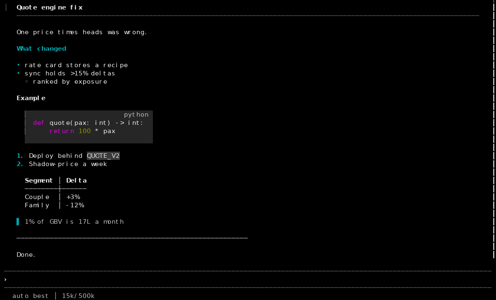
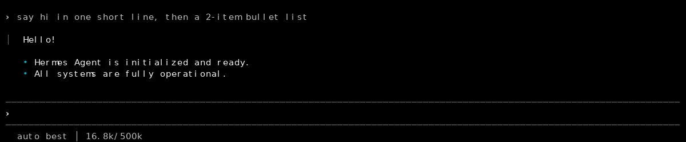

# hermes-tui-minimal

A quieter, denser look for the [Hermes Agent](https://github.com/NousResearch/hermes-agent) terminal UI (the Ink TUI, `display.interface: tui`), kept alive across `hermes update`.

No fork. `apply.py` patches the Hermes checkout in place with exact-string anchors, the TUI rebuilds itself on the next launch, and a shell wrapper re-applies the patches after every update. If upstream moves an anchor, `apply.py` tells you which one instead of guessing.





## What changes

**Chrome**
- No startup banner / session box. The prompt sits between two thin rules at the bottom.
- Status strip is plain text under the prompt: `model │ 16.8k/500k │ ⎇ main`. No `ready`, no cwd, no idle clock, no `[████░░]` bar.
- Thinking verb shows on the row above the prompt, no kaomoji face, no timer.
- Finished tool rows get a green `✓` / red `✗` instead of the same `●` for every state.
- Optional status fields that upstream doesn't have: `cost` (`$1.23` / `~$1.23`), `turn_time` (`⏱ 42s`), `git_branch` (`⎇ main`), `hints` (shortcut cheatsheet while idle).

**Reply markdown ("Editorial")**
- `#` bold primary + full-width rule · `##` bold accent · `###` bold primary (upstream renders all levels the same).
- Code blocks: shaded fill (`code_bg` skin key), `▏` gutter, right-aligned italic language tag.
- Bullets accent `•`, nested `◦`; numbered lists bold accent; quotes `▌` + italic.
- Inline code on a grey chip; tables with `│` columns and a `─┼─` header rule; `---` half-width.

**macOS Terminal.app over SSH**
- Copy-on-select works over SSH: a transcript drag or prompt-box drag is sent to your clipboard via OSC 52 with a `✓ copied N chars` notice (⌘C can't reach the app while the TUI owns the mouse; Fn+drag then ⌘C is the fallback).
- Fixes the stray `p` bottom-left and stale dots Terminal.app leaves behind.
- The wrapper exports `TERM_PROGRAM=Apple_Terminal COLORFGBG=15;0` over SSH so the TUI applies its Terminal.app colour/redraw handling (SSH doesn't forward `TERM_PROGRAM`).

**/model picker**
- No `(no key)` rows for providers you haven't configured; `model_catalog.excluded_providers` also hides `providers:` config rows.

**Skins**
- `quiet-ansi` — uses your terminal profile's 16 ANSI slots, so it follows your terminal theme. Avoids `ansi:blue` (unreadable on Terminal.app black).
- `quiet` — fixed hex (Nord-ish) fallback.

## Install

Requirements: a source install of Hermes Agent at `~/.hermes/hermes-agent` (the default), Python 3, git.

```bash
git clone https://github.com/saumya-dabi/hermes-tui-minimal ~/.hermes/tui-minimal
~/.hermes/tui-minimal/install.sh
```

`install.sh` copies the skins to `~/.hermes/skins/`, adds the `hermes()` wrapper to your `~/.bashrc` (or `~/.zshrc`), sets the config keys below, and runs `apply.py`. Open a new shell and run `hermes`; the first launch rebuilds the TUI from source (~1 min).

Manual equivalent:

```bash
cp skins/*.yaml ~/.hermes/skins/
cat shell/hermes-wrapper.sh >> ~/.bashrc
hermes config set display.interface tui
hermes config set display.skin quiet-ansi
hermes config set display.tui_statusbar bottom --force
hermes config set display.tui_native false
hermes config set display.tui_compact true
hermes config set display.mouse_tracking all --force
hermes config set display.resume_display minimal
hermes config set display.status_bar.fields '["model","context_detail","git_branch"]'
hermes config set display.turn_summary false
hermes config set display.turn_completion_explainer false
hermes config set display.credits_notices false
hermes config set display.details_mode collapsed
python3 apply.py
```

(`--force` is needed on a couple of keys that the config validator doesn't know yet; the "not a recognized key" warning is a false alarm — the TUI reads them.)

## Usage

```
apply.py            apply (no-op if already applied)
apply.py --check    exit 1 if not fully applied; names the file/anchor
apply.py --revert   git-restore the touched upstream files
apply.py -q         quiet unless something fails
```

Environment: `HERMES_AGENT_ROOT` (default `$HERMES_HOME/hermes-agent` → `~/.hermes/hermes-agent`).

`hermes update` through the wrapper: revert → update from a clean tree → re-apply. If you run `/update` from inside the TUI (bypasses the wrapper), the patches are parked in a git stash and come back on the next shell launch.

## Picking what you want

`PATCHES` in `apply.py` is a dict of `file → [(upstream_text, replacement), …]`, numbered in comments (#1 hide intro … #17 markdown). Delete the entries you don't want. Dependencies: #12 (status extras) needs `appChrome.helpers.ts`; #17 needs both the `markdown.tsx` and `theme.ts` entries; #11 touches both `appLayout.tsx` and `appChrome.tsx`.

The `cost` status field also needs the `gateway/session_usage.py` patch and a gateway restart (`hermes gateway restart`).

## Verify without tmux

```bash
pip install pyte wcwidth pillow
APPLETERM=1 python3 verify/tui_drive.py /tmp/t wait:60 snap:boot "send:hello" "send:\r" wait:30 snap:turn
python3 verify/tui_render.py /tmp/t.turn.raw      # prints the screen, writes .png + .html
```

`tui_drive.py` runs the TUI in a pty (120×40) and records raw output; `APPLETERM=1` emulates Terminal.app over SSH (no `COLORTERM`, Apple_Terminal palette). `mockups/gen.py` renders the three markdown styles that were compared before "Editorial" was chosen.

## Known limits

- Pinned to upstream as of commit `bf0203a79` (Oct 2026). Anchors are exact strings; when one breaks, `apply.py` prints `file: first line of anchor`. Fix the anchor, open an issue, or delete that patch.
- Upstream test `appChromeBlockedTimers.test.tsx` fails with the patches applied (it asserts the face ticker and idle clock that are removed). `markdown*.test.ts` assert the old glyphs.
- `quiet-ansi` is TUI-only: the classic CLI (`display.interface: cli`) expects hex colours.
- Code-block fill uses `ansi256(235)`; terminals without 256-colour support show no fill (set `code_bg: ""` to disable).

## License

MIT
